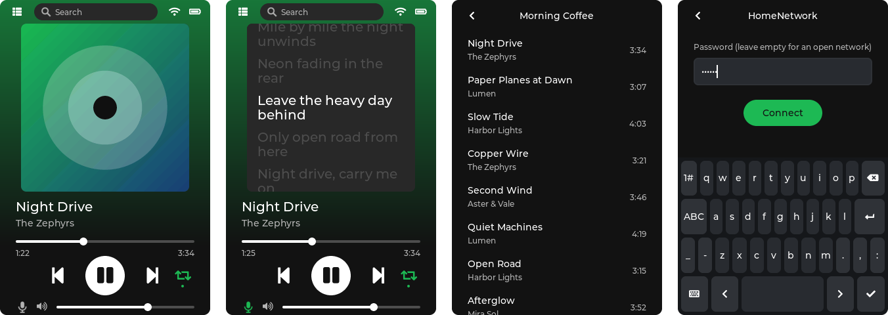

# zspot

  

A Spotify Connect player for devices running
[Zephyr RTOS](https://zephyrproject.org), with the Spotify protocol packaged
as a Zephyr module.

  

<em>Now Playing, lyrics, a playlist from Your Library and the Wi-Fi password entry, on native_sim with demo data.</em>

- Shows up as a device in the Spotify app and plays through an I2S DAC.
- Now Playing screen with cover art, progress, seeking, transport, repeat
  and volume controls.
- Search, Your Library (Liked Songs and playlists) and synced lyrics on the
  device.
- Wi-Fi setup on the screen.
- Runs on the ESP32-S3 (VIEWE UEDX32480035E-WB-A) and on `native_sim`.
- The protocol library (`lib/zspot`) has a plain C API and can be used
  without the player.

A Spotify Premium account is required.

## Documentation

The full documentation is at <https://walidbadar.github.io/zspot/>.

- [Getting started](https://walidbadar.github.io/zspot/getting_started.html): requirements,
  [setting up a workspace](https://walidbadar.github.io/zspot/getting_started.html#setting-up-a-workspace)
  and the repository layout.
- [The player](https://walidbadar.github.io/zspot/player.html): building for the
  [ESP32-S3](https://walidbadar.github.io/zspot/player.html#esp32-s3) and
  [`native_sim`](https://walidbadar.github.io/zspot/player.html#native-sim), the controls, and the setup of
  [Search and Your Library](https://walidbadar.github.io/zspot/player.html#search-and-your-library).
- [Hardware](https://walidbadar.github.io/zspot/hardware.html): the board, the
  [I2S pins](https://walidbadar.github.io/zspot/hardware.html#i2s-pins) and the amplifier.
- [The library](https://walidbadar.github.io/zspot/library.html): a
  [minimal example](https://walidbadar.github.io/zspot/library.html#minimal-example), the API, events and
  configuration.
- [Architecture](https://walidbadar.github.io/zspot/architecture.html) and
  [Troubleshooting](https://walidbadar.github.io/zspot/troubleshooting.html).

## Licence

GPL-3.0, like [cspot](https://github.com/feelfreelinux/cspot), from which the
protocol core is derived. See the [licence page](https://walidbadar.github.io/zspot/licence.html) for the
bundled code and trademarks.
